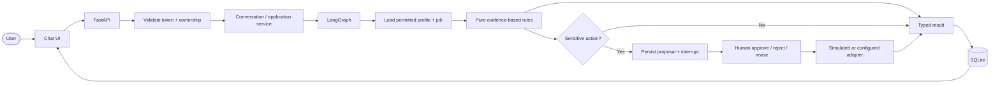
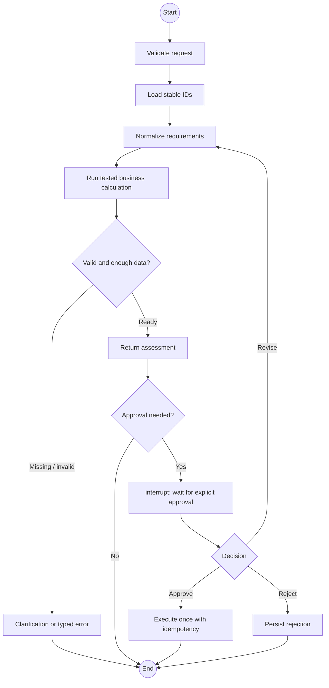

# CareerPilot AI

> Evidence before action. A local, explainable career workspace with a chat-first UI.


## What it does

| Area | Capability |
|---|---|
| Chat | Bounded English/Arabic commands with persistent conversations |
| Jobs | Local/synthetic discovery, normalization, and duplicate detection |
| Analysis | Evidence-based matches, gaps, unknowns, and hard/soft requirements |
| Documents | CV, cover-letter, and interview-practice drafts linked to evidence |
| Safety | Owner checks, immutable approval proposals, simulated external actions |
| Reliability | SQLite persistence, checkpoints, recovery, idempotency, audit events |
| AI | Optional provider adapter; deterministic demo works without an API key |

## System map



### Where LangGraph fits



LangGraph coordinates state, nodes, conditional routing, checkpoints, and interrupts.
Business rules remain ordinary Python outside the graph, so they are independently
testable. LangChain is limited to provider/tool boundaries; it does not own
authorization or approval decisions.

## Quick start

```sh
uv sync --locked
uv run --locked careerpilot-demo
uv run --locked careerpilot-server --directory work/demo-server --port 8765
```

Open <http://127.0.0.1:8765/> and use the development access token generated for the
local server. Choose **Load synthetic examples**, then try:

```text
Show my jobs
Analyze job
What information is missing?
Prepare my application
Show my pending approvals
```

All demo records are synthetic. Sending messages, submitting applications, and job
search outside local fixtures are simulated or disabled.

## Project shape

```text
src/careerpilot/
├── domain/          validated entities and business rules
├── application/     use cases, chat, security, and contracts
├── workflows/       LangGraph orchestration
├── providers/       optional model adapters
├── integrations/    local fixtures and simulated actions
├── persistence/     SQLite repositories and checkpoints
├── api/             FastAPI transport
└── web/             static chat-first interface
```

## Verify locally

```sh
PATH="$PWD/work/tooling-env/bin:$PATH" sh scripts/check.sh
```

The normal suite is offline. Live provider tests are opt-in and skipped unless explicitly
configured. See [docs/known-limitations.md](docs/known-limitations.md),
[docs/security.md](docs/security.md), and [docs/demo-script.md](docs/demo-script.md).

## Important boundaries

- No hiring probability is inferred from the baseline assessment.
- AI output cannot silently change confirmed profile facts.
- Approval is an authenticated application event, not a model statement.
- External effects are simulated unless a separately configured adapter is enabled.
- This is a local technical preview, not a production deployment.
