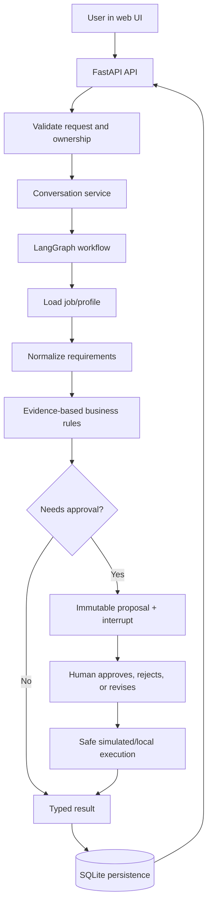

# CareerPilot AI

CareerPilot AI is a modular Python career-management technical preview with an
owner-scoped local API/interface, evidence-based job analysis, conservative versioned
CV/cover drafts, interview practice, confirmed memory and durable human approval.
External job discovery and sending are simulated/local; real model extraction is an
explicit optional CLI adapter. No production deployment or live provider quality is
claimed. Phases 1–14 are documented, with verified results and residual risks in the
[final audit](docs/final-audit.md), [manager demo](docs/demo-script.md) and
[known limitations](docs/known-limitations.md).

## How the system works

CareerPilot is a local, owner-scoped career workspace. The user sends a bounded
command through the web UI or API; the application validates it, loads only the
user's permitted records, runs the relevant workflow, and stores the result. The
default demo is deterministic and uses synthetic data. External sending and job
search are simulated/local.



LangGraph coordinates state, nodes, conditional routes, checkpoints, and human
interrupts. Business rules live outside the graph so they can be tested without
an LLM. LangChain is used only for provider/tool boundaries where needed; the
demo works offline and does not require an API key.

### Main capabilities

- Evidence-based job-fit analysis with explicit matches, gaps, and unknowns.
- Synthetic/local job discovery and deduplication.
- CV, cover-letter, and interview-preparation drafts linked to profile evidence.
- Persistent conversations, resumable workflow state, and confirmed memory.
- Human approval before simulated recruiter messages, submissions, or sensitive changes.
- Optional real model integration through validated provider configuration.

### Run the demo

```sh
uv sync --locked
uv run --locked careerpilot-demo
uv run --locked careerpilot-server --directory work/demo-server --port 8765
```

Open `http://127.0.0.1:8765/`, use the development token generated for the local
server, and load the synthetic examples. No real user data or external action is
used by this demo.

## Supported environment

Python **3.12.x** (`>=3.12,<3.13`); locally verified on macOS with Python 3.12.4.
Other Python minor versions are intentionally unsupported until tested.
Use uv 0.13.6 (the version used to generate `uv.lock`).
Install uv using the [official installation guide](https://docs.astral.sh/uv/getting-started/installation/).
No system Python packages need modification.

```sh
uv sync --locked
cp .env.example .env
uv run --locked careerpilot-approval
uv run --locked careerpilot-memory
uv run --locked careerpilot-prepare
uv run --locked careerpilot health
uv run --locked careerpilot-discover
uv run --locked careerpilot-discover --import-file examples/discovery/imported-jobs.json
uv run --locked careerpilot-extract
uv run --locked careerpilot-demo
uv run --locked careerpilot-demo --scenario missing-information
uv run --locked careerpilot-demo --scenario hard-gap
sh scripts/check.sh
```

`careerpilot health` prints a fixed JSON process-health result to stdout and
allowlisted JSON events to stderr. It does not establish external service readiness.
Configuration loads from `.env` in the working directory, then environment variables
take precedence. Invalid environment/log-level values fail validation at startup.
Core settings are `CAREERPILOT_ENVIRONMENT` and `CAREERPILOT_LOG_LEVEL`. Separate
validated LLM settings are described in [LLM integration](docs/llm-integration.md).
Production is a validated environment label, not a deployment capability.

## Quality checks

```sh
uv lock --check
uv run --locked ruff format --check .
uv run --locked ruff check .
uv run --locked mypy
uv run --locked pytest
```

To format intentionally: `uv run --locked ruff format .`.
The shell script executes these checks in order and stops on failure. Tests use
synthetic fixtures, isolate `.env` and environment variables, and need no network.
An initial installation needs package-index access. Normal tests deny socket
connections and never run live LLM tests. The paid integration test is skipped by
default, even when credentials exist. See the explicit opt-in procedure in the LLM
guide; offline commands above require no credential.

## Layout and dependencies

- `src/careerpilot/application/discovery*.py`: typed contracts, bound authorization, discovery and pure deduplication.
- `src/careerpilot/integrations/local_jobs.py`: bounded local fixtures/operator-approved JSON imports.
- `src/careerpilot/integrations/mock_companies.py`: company metadata mock, no URL fetching.
- `src/careerpilot/tools/langchain.py`: six optional scoped LangChain tools, no agent.
- `src/careerpilot/workflows/discovery.py`: bounded search/normalize/deduplicate/assess graph.
- `src/careerpilot/discovery_demo.py`: local demo with a trusted synthetic grant and temporary DB.
- `docs/discovery-tools.md` and `examples/discovery/`: contracts, permissions, limitations and actual sample output.
- `src/careerpilot/domain/extraction.py`: strict extraction schemas and field-state rules.
- `src/careerpilot/application/extraction.py`: model port, error types, grounding/provenance.
- `src/careerpilot/application/extracted_jobs.py`: unreviewed job snapshot preparation.
- `src/careerpilot/providers/`: mock/OpenAI adapters, settings and the model factory.
- `src/careerpilot/application/chat_agent.py`: bounded provider-neutral natural-language agent loop.
- `src/careerpilot/agent_portal.py`: strict owner-bound chat tool registry.
- `src/careerpilot/workflows/chat_agent.py`: LangGraph routing and restart-safe chat checkpoints.
- `docs/chat-agent-graph.md`: graph state, recovery and approval boundaries.
- `src/careerpilot/workflows/extracted_job.py`: extraction entry point reusing the original graph.
- `src/careerpilot/extract_demo.py`: opt-in LLM/mock command with a synthetic candidate.
- `examples/extraction/`: actual offline input/output, checked against execution.
- `docs/llm-integration.md`: providers, configuration, trust, costs and testing.
- `src/careerpilot/workflows/job_analysis.py`: typed LangGraph state, nodes and explicit routes.
- `src/careerpilot/application/analysis.py`: typed requests/results and analysis use cases.
- `src/careerpilot/integrations/synthetic.py`: stable local fixtures and seed adapter.
- `src/careerpilot/demo.py`: executable temporary-database demo.
- `examples/job-analysis/`: generated, regression-tested sample requests/results and Mermaid graph.
- `docs/job-analysis-workflow.md`: nodes, edges, baseline rules, execution and limitations.
- `src/careerpilot/domain/`: profile/evidence, jobs/fit, documents/applications and governance rules.
- `src/careerpilot/application/storage.py`: typed transaction-scoped storage contract and errors.
- `src/careerpilot/persistence/`: explicit SQLite initialization, transactions and schema v3 (additive v1/v2 upgrades).
- `src/careerpilot/application/health.py`: transport-independent local health use case and schema.
- `src/careerpilot/config.py`: explicit Pydantic Settings configuration.
- `src/careerpilot/observability.py`: standard-library JSON logging with fixed event names.
- `src/careerpilot/cli.py`: CLI adapter and dependency composition root.
- `tests/`: behavioral, privacy, validation, CLI, and application-import boundary checks.
- `scripts/check.sh`: portable local verification gate.
- `docs/data-model.md`: entities, integrity rules, persistence usage and compatibility limits.
- `docs/architecture.md`: implemented and planned module boundaries.
- `docs/decisions/ADR-001-initial-architecture.md`: decision and tradeoffs.
- `pyproject.toml` and `uv.lock`: dependency constraints and exact resolved versions.

Runtime dependencies are Pydantic for schema validation and pydantic-settings for
environment configuration. Development tools are Ruff, mypy, and pytest. Hatchling
builds the installable src-layout package. Phase 3 adds LangGraph 1.2.18 for actual
orchestration. Phase 4 uses langchain-core 1.7.0 directly, langchain-openai 1.7.3
and OpenAI SDK 3.40.0 for the optional real adapter. No standalone LangChain agent
or tool-execution framework is added. LangSmith 0.14.14 is also declared directly
because the runner uses its documented `tracing_context(enabled=False)` to prevent
ambient host settings from exporting traces. No LangSmith service is enabled.
SQLite continues to use the standard library. The updated `uv.lock` contains exact
versions. Phase 12 adds FastAPI/Uvicorn and a static local interface; urllib3
configures zero hidden telemetry retries. httpx2 is declared for in-memory
SDK transport tests; normal tests never contact the API. Phase 5 reuses existing
LangChain/LangGraph dependencies and introduces no new package.

Update dependencies deliberately with `uv lock --upgrade-package PACKAGE`, then run
all checks and review the lock diff. Do not edit `uv.lock` manually. See
[uv locking documentation](https://docs.astral.sh/uv/concepts/projects/sync/).

## Scope and limitations

The starting folder had no Git metadata or application files. No hosting platform
was identifiable; a GitHub quality workflow is now supplied for future adoption,
without a claimed remote run. Once the hosting platform
is selected, its CI should install the documented Python/uv versions, run
`uv sync --locked`, then `sh scripts/check.sh`. No remote repository or production deployment
has been created. Initialize/attach Git and commit source plus `uv.lock` before
collaborating; never commit `.env` or personal artifacts.

Logging deliberately drops arbitrary messages, arguments, exceptions, and extra
fields. This reduces accidental personal-data logging at the cost of diagnostics.
It only governs the CareerPilot logger: future third-party integrations need their
own review. No telemetry/exporter exists. SQLite is opt-in and local only; the health
command does not open a database. See [the data model](docs/data-model.md) for usage and
[ADR-002](docs/decisions/ADR-002-local-persistence.md) for persistence decisions.


## Deterministic job analysis

The demo seeds bundled synthetic jobs/profiles into an automatically cleaned-up
temporary SQLite database. It never touches an existing development database.
Run `uv run --locked careerpilot-demo --input examples/job-analysis/complete-input.json`
to reproduce the checked-in sample output. No key, network, model or job search is
needed. The runner disables tracing even if host environment settings enable it.

Results distinguish execution status (`completed`, `needs_information`, `error`)
from mandatory-rule decisions (`eligible`, `ineligible`, `needs_review`). They show
evidence-based per-requirement findings and counts, with **no score or hiring
probability**. Missing skills are unknown, not invented gaps. See
[the workflow](docs/job-analysis-workflow.md) for exact policy and limits.


## Optional structured extraction

`careerpilot-extract` uses the bundled synthetic source and candidate by default.
Mock mode supports that fixture only and rejects arbitrary input rather than
fabricating an extraction. OpenAI mode requires explicit provider/model/API-key
configuration; no Codex session credential is read or assumed. The real path is
implemented and tested through in-memory HTTP simulation; a live call was not
performed during Phase 4.

Extracted claims retain exact source snippets and unreviewed provenance. Candidate
facts are never sent to the model or edited. All extracted results require review;
unsupported/contradictory/missing data is preserved. Read
[the integration guide](docs/llm-integration.md) before enabling paid calls.


## Local discovery and scoped tools

`uv run --locked careerpilot-discover --import-file examples/discovery/imported-jobs.json`
searches registered synthetic/local sources, normalizes and deduplicates their results,
and assesses at most 10 jobs. The checked-in sample removes two duplicates and keeps
both source references for each job. Results are advisory and tagged as untrusted
source content; no model or commercial job-board call occurs.

Tool inputs accept bounded queries and IDs, never a file path, SQL, shell command or
server-fetch URL. An application-supplied access grant scopes operations, candidates,
companies and sources outside model input. The import-file CLI option is trusted
operator configuration; it is not an agent tool. Optional LangChain bindings reuse
the same authorization checks and are not bound to the Phase 4 extraction model.
See [tool contracts and source limits](docs/discovery-tools.md).

## Evidence-linked career preparation

Phase 6 adds explained matches/gaps, targeted clarifications, evidence-only CV and
cover-letter drafts, interview questions and a practice plan. Drafts preserve the
original CV, append immutable versions and link each claim to profile evidence.
The mock planner runs offline; optional real planning selects existing fact IDs
only and requires separate explicit profile-export permission. All drafts require
human review. No hiring probability or application submission is produced.

See [preparation guide](docs/career-preparation.md),
[ADR-006](docs/decisions/ADR-006-evidence-linked-preparation.md) and
[actual synthetic examples](examples/preparation/ready-result.json).
Schema v2 is an atomic additive upgrade; backup and downgrade limitations are
documented in the guide.

## Memory and resumable context review

Phase 7 adds an owner-scoped, explicitly confirmed memory repository and a
reference-only context review graph with SQLite checkpoints. It supports pause,
restart/resume, authorized state/history, corrections/deletion and bounded context.
Earlier workflows retain their existing persistence behavior. Memory never silently
changes domain profile facts or generated documents.

Run `uv run --locked careerpilot-memory` for a synthetic temporary demonstration,
or follow [durable local pause/resume commands](docs/memory-and-checkpointing.md).
The [guide](docs/memory-and-checkpointing.md) explains the four storage boundaries,
confirmation/authentication responsibilities, deletion/backup policy and tested
local durability limits. See [ADR-007](docs/decisions/ADR-007-memory-and-reference-checkpoints.md).

## Human approval for sensitive actions

Phase 8 stages recruiter messages, application submissions and consequential local
status changes as immutable proposals. Exact-version authenticated review events
resume a LangGraph interrupt. Rejection/revision, expiry, stale-content checks,
durable execution claims and outcome/audit persistence prevent silent approvals
or automatic duplicate sends. External effects are simulated; local status changes
are transactional. Simulation never marks an application submitted.

Run `uv run --locked careerpilot-approval` for a synthetic temporary example.
See [approval lifecycle/security guide](docs/action-approval.md),
[ADR-008](docs/decisions/ADR-008-exact-version-action-approval.md) and
[actual examples](examples/approval/message-approval.json). Business schema is now
v3; backup non-disposable data before explicit initialization/upgrade.

## Local interface, security and audit

Phases 9–13 add cooperative runtime budgets/recovery, owner-scoped local bearer
access, metadata-only optional LangSmith telemetry, deterministic offline evaluation,
and a FastAPI/static-JavaScript interface. External sending and API model generation
remain simulated/offline. See [API guide](docs/api.md), [security](docs/security.md),
[reliability](docs/reliability.md), [evaluation](docs/observability-evaluation.md),
[deployment](docs/deployment.md) and [operations](docs/operations.md).

```sh
uv sync --locked
uv run --locked careerpilot-server --directory work/server --init
uv run --locked careerpilot-server --directory work/server
# Open http://127.0.0.1:8000, paste the private local token, Connect, Load synthetic examples.
sh scripts/check.sh
uv run --locked careerpilot-evaluate --output work/eval-current.json --baseline evals/baseline-v1.json
```

Node 22 is needed for UI tests; no frontend build is required. The gate now also
checks JavaScript, three UI safety tests and all deterministic evaluations. The
GitHub workflow is provided for future hosting; no remote CI execution or production
deployment is claimed. Do not publish local access files, databases or actual secrets.

### Persistent chat demo

The primary interface is now a bounded English/Arabic chat assistant, running offline
with no model key. Existing workspace/review tools remain under Workspace details.
Try `Show my jobs`, `Analyze job`, `Prepare my application` or `اعرض الوظائف`,
`حلل الوظيفة`, `جهز التقديم`. Choose resources with the returned buttons. “yes” never
approves an action. After refresh, reconnect using the same in-memory-token flow to
restore persisted history and pending clarification. See docs/chat.md for commands,
contracts, retention and limitations.

For existing storage, stop and back up the service, then run
`uv run --locked careerpilot-server --directory work/server --migrate` before restart.
This creates a separate conversations.sqlite3 v1; business schema v3 stays unchanged.
The stopped-service backup command includes transcripts. No general LLM conversation,
external job search, uploads, streaming or real sending is enabled.
