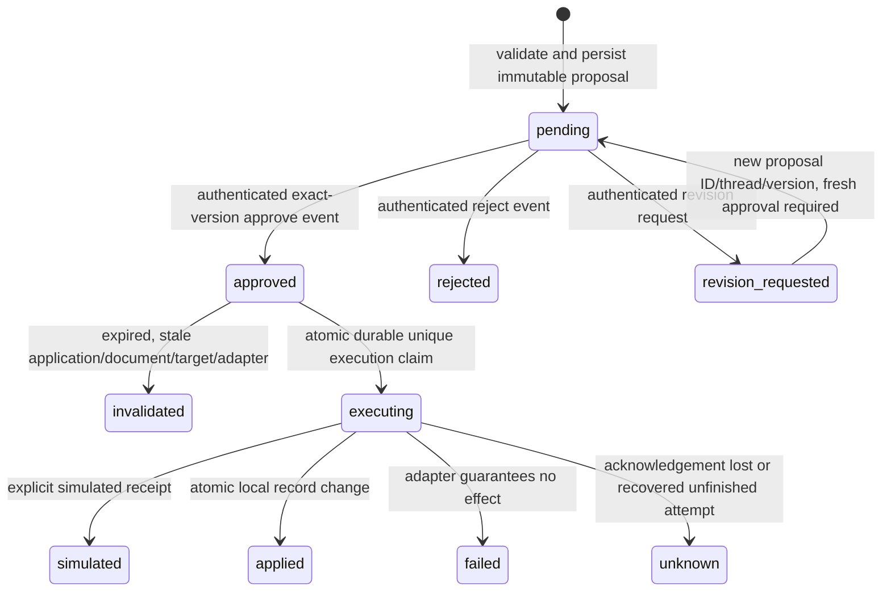

# Phase 8: human approval for sensitive actions

CareerPilot implements a real persisted approval lifecycle and LangGraph interrupt,
with **simulated external effects only**. Local consequential application-status
changes are real, transactional business updates. No recruiter message or application
is sent externally. Existing approval/document APIs keep their historical behavior;
the new workflow is the guarded entry point for these staged actions, not a claim
that every legacy low-level repository call has acquired a global approval gate.

## Supported actions and review surface

| Action | Exact reviewed content and prerequisites | Execution |
| --- | --- | --- |
| Recruiter message | Registered/scoped target snapshot, subject and body, current application fingerprint | Explicit simulated adapter |
| Application submission | Registered/scoped destination, ready application, selected candidate-owned resume version and content SHA-256 | Explicit simulated adapter; application stays ready |
| Consequential record change | Current application fingerprint, target status and reason; valid domain transition | Local status update, outcome and both audit records commit together |

Targets are injected application configuration: an opaque UUID, kind, visible label,
route key and revision. A model cannot choose arbitrary URLs or addresses. Target
configuration changes invalidate approval. Subjects reject control characters and
message bodies have bounded validated content. Existing domain rules still govern
application transitions. A status change to submitted is deliberately excluded from
the record-change action; it cannot masquerade as an actual submission.

`ActionReview` returns the complete immutable proposal, hash/version, target snapshot,
decision/outcome and, for submission, the selected resume text for review. Fetch it
through the owner-bound service; do not approve an ID without showing this content.
The example CLI prints synthetic content intentionally, not to application logs.
No LLM is involved in preparing or granting these demo decisions.

## State machine



The revision edge creates a **different** proposal; the old revision-requested record
never returns to pending. Each proposal has one immutable decision at most. A new
revision has a new stable proposal ID, thread ID, incremented version and predecessor
link. One predecessor has at most one successor. New hashes include identity/version,
owner/application/candidate/job references, content, target snapshot, adapter ID,
application fingerprint and validity window. Proposal fields cannot be edited.

Approve is allowed only while the proposal and prerequisites are current. Expiry
is exclusive (`now < expires_at`) and bounded to at most 24 hours at creation.
Reject/revise can close an expired or stale proposal without authorizing execution;
the next proposal must validate afresh and receive a new approval. The old decision
cannot be copied to its revision. Failed/unknown actions are not automatically retried.

## Modules and durable records

- `domain/actions.py`: validated discriminated content, proposal, review/decision,
  outcome and audit contracts.
- `application/action_contracts.py`: trusted principal, action database/adapter ports
  and explicit errors.
- `application/actions.py`: hashing, prerequisites, permission checks, exact-version
  review, execution claims, outcomes and owner-scoped audit retrieval.
- `persistence/actions_sqlite.py`: action records in the same transaction/connection
  as existing business records; existing storage adapter invariants are reused.
- `workflows/action_approval.py`: reference-only LangGraph orchestration and resume.
- `integrations/simulated_actions.py`: isolated durable simulated-effect ledger,
  including success, definite failure and acknowledgement-loss test modes.
- `approval_demo.py`: synthetic composition root and CLI, no actual authentication
  or live transport.

Business schema v3 adds proposals, mutable lifecycle status, immutable user decisions,
one execution attempt/idempotency key per proposal, immutable outcome and audit
rows. Foreign keys bind decisions to proposal ID/thread/owner/version/hash and bind
proposals to candidate-owned applications. Unique constraints protect thread IDs,
revision lineage, decisions, attempts and outcomes. SQL triggers reject UPDATE/DELETE
of proposals, decisions, attempts, outcomes and action audit records. Service checks
also recompute the proposal hash. This is not a tamper-proof ledger against someone
able to replace database files or drop triggers.

`SQLiteDatabase.initialize()` atomically upgrades v1/v2 to v3 and preserves existing
JSON payloads/CVs. Backup non-disposable data first; downgrade is unsupported and
old versions reject v3. Migration rollback, old document preservation and foreign-key
integrity are tested. The separate Phase 7 memory schema and checkpoint format are
unchanged. The existing migration regression now expects schema v3; all of its
preservation/rollback assertions remain. No dependency versions or packages changed.

## Interrupt/replay and execution safety

The graph is START → human_review → execute_action or finish_without_execution → END.
The interrupt payload and saved state contain only proposal/thread/owner IDs, hash,
workflow version and persisted decision reference. Content and audit authority stay
in business tables. The saver thread key is `approval:<UUID>`, preventing collisions
with context-review threads. No source text, resume document or message body is
copied into checkpoint history. Tracing is disabled around all graph operations.

`prepare()` persists the proposal before graph start, then `interrupt()` pauses in
human_review. That node performs no writes or external calls before the interrupt.
The authenticated application calls `resume(ReviewDecision(...))` with the exact
thread, proposal version and hash. The service commits an immutable user event,
then the wrapper invokes `Command(resume=event_id)` on the same thread using
`durability="sync"`. On re-entry the node loads that event and verifies its binding;
a bare boolean, invented event ID or LLM claim that approval exists grants nothing.

Execution is in a different node. It rechecks ownership/current permissions, event,
expiry, application fingerprint, selected document hash, target configuration and
adapter identity immediately before claiming an attempt. A unique claim is committed
**before** the adapter call. Re-entry reads the existing outcome or marks an unfinished
claim unknown; it never makes a second automatic call. The simulation also durably
deduplicates the proposal/hash-derived idempotency key after adapter restart.

For local record changes, claim, domain transition, its legacy application audit,
action outcome and action audit share one transaction. A storage failure rolls them
all back, so retrying that local transaction cannot repeat a committed mutation.
For external simulation, no database transaction is held across the adapter call.
A timeout, malformed receipt or unexpected error is unknown because an effect might
already have happened; a typed definite-no-effect error is failed. Receipt loss is
not reported as success and never triggers automatic sending again.

`recover(thread)` reuses a previously committed authenticated decision after a crash;
it does not create approval. It can start the graph from a persisted proposal when
checkpoint creation failed, or resume waiting/retry a pending graph node. A crash
after an execution claim but before a durable outcome is deliberately unknown,
even if the effect never started. If another concurrent worker observes executing,
it may conservatively mark unknown while the first finishes; the authoritative
unknown outcome stays sealed. Concurrent graph invocation is not a distributed
exactly-once scheduling guarantee, but the business claim prevents duplicate calls.

There is no atomic transaction spanning remote execution and our database. Once an
attempt has started, a later application edit/revocation cannot unsend it; checks
occur at the durable claim boundary. Reconcile unknown outcomes with independent
provider evidence before deliberately authorizing a new action. Automatic provider
reconciliation, cancellation and production queues are deferred. Simulation receipts
are always labeled simulated and never mark an application submitted.

## Authentication and security boundaries

ActionPrincipal is a server-constructed snapshot of authenticated owner/actor,
allowed candidates, action permissions and allowed target IDs. Every review/resume/
recovery/execution/audit read checks owner/resource scope; IDs alone are not authority.
Permission revocation is enforced by constructing the current principal for each
request. The service does not cache authentication sessions. An application must
actually authenticate and obtain an explicit user review event before calling
`decide`; injecting `approved=True` from a model is not a trusted event.

No action decision/execution function is exposed as a LangChain tool, and no document
or assistant output can grant permissions. Proposal/review models reject extra fields
such as model-supplied owner or approval authority. The process and adapter code are
trusted; raw SQL, direct saver access and legacy repository methods are not exposed
as user APIs. A future API must route sensitive writes through this service and must
not expose the legacy mutation methods as an approval bypass.

ActionService defaults to no external adapter and refuses external proposals in that
mode. The provided adapter is an explicitly injected local simulator. There is no
real sending/submission implementation or credential configuration. A future live
adapter requires separate design review for authenticated destinations, idempotency,
timeouts, receipt validation/reconciliation, costs/permissions, and distinguishing
real success from simulation; it must not simply relabel this simulation as delivery.

Proposals/decisions/audits contain reviewed career content or stable references and
remain business records. Phase 7 memory deletion does not erase them. No raw content,
provider exception or resume is logged by this feature. Files/backups remain local
plaintext and need a retention/access policy before real personal data is used.
No production authentication, compliance or availability guarantee is claimed.

## Demonstration and verification

```sh
uv run --locked careerpilot-approval
uv run --locked careerpilot-approval --scenario submission
uv run --locked careerpilot-approval --scenario record-change
```

Each default demo uses a fresh temporary database. For separate processes on a
fresh disposable directory (same scenario each time):

```sh
uv run --locked careerpilot-approval --directory work/approval-demo --operation prepare
uv run --locked careerpilot-approval --directory work/approval-demo --operation state
uv run --locked careerpilot-approval --directory work/approval-demo --operation approve
```

Use `reject` or `revise` instead of approve; `recover` only reuses an existing decision.
The CLI has a fixed synthetic principal and stable synthetic IDs, not real user login.
Use a fresh directory for another run; existing immutable proposal IDs are not reused.
Revision proposals are created through ProposalRequest(previous_proposal_id=...), as
covered by the tests; the CLI does not automatically revise or approve new wording.

Actual examples are under `examples/approval/`: three action approvals, rejection,
revision request, an ambiguous receipt-loss outcome and actual Mermaid graph. IDs,
times and hashes reflect real local execution and differ on regeneration.
Run all gates with `sh scripts/check.sh`. Normal tests block network and keep live
LLM tests opt-in. Tests cover approval/rejection/revision, edited inputs/records,
expiry, permission/owner isolation, repeat resume, restart while waiting, a decision
saved before Command, concurrent claims/decisions, receipt loss, durable adapter
idempotency, atomic rollback, schema upgrades and simulation-vs-submission semantics.

Official [interrupt documentation](https://docs.langchain.com/oss/python/langgraph/interrupts)
explains node re-entry and Command(resume). The
[persistence guide](https://docs.langchain.com/oss/python/langgraph/persistence)
explains thread/checkpointer identity. Installed LangGraph 1.2.18 signatures and
execution were verified; no newer guide-only API or additional package is required.
