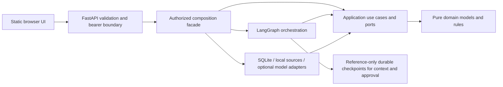

# Architecture

## Scope

CareerPilot AI is a modular monolith with a local FastAPI/static-JavaScript interface.
Domain rules and validated models remain independent of LangGraph, HTTP and model
vendors. Application use cases own ports; SQLite/local/provider adapters implement
them. Portal/server/demo modules are composition roots. Security tokens and ownership
are enforced before exposing user-owned data; raw repository methods are trusted
internal capabilities. External actions are simulated and the API uses offline
planning. The optional real model adapter is explicit CLI configuration, unverified
against a live provider in this project.

## Dependency direction and boundaries

| Boundary | Responsibility | Allowed dependencies | Current state after Phase 14 |
| --- | --- | --- | --- |
| Domain (`domain/`) | Career entities, value objects, business invariants | Standard library and Pydantic; no I/O | Profiles/jobs/fit/documents/actions/memory/evidence and runtime contracts |
| Application (`application/`) | Use cases, typed input/output; define ports when needed | Domain, standard library, Pydantic | Analysis/extraction/preparation, confirmed memory, staged actions and execution limits |
| Workflows (`workflows/`) | LangGraph State, Nodes, transitions; delegate business work | Application/domain schemas, LangGraph; injected services | Analysis/discovery/preparation plus checkpointed context/approval graphs |
| LLM (`providers/`) | Translate typed requests/results, provider errors and timeouts | LangChain integration/SDK, application-owned extraction port | Mock and opt-in OpenAI native structured output; no credentials stored |
| Source adapters (`integrations/`) | Local search/import and mock company data | Application-owned source contracts, domain models | Local fixtures/JSON import only; no network job board |
| Tool bindings (`tools/`) | Optional LLM-callable schema/error translation | Application/domain contracts, LangChain core | Six scoped read tools; no agent or arbitrary I/O |
| Persistence (`persistence/`) | Repository implementations, transactions and mapping | Storage clients, domain, application ports | Business schema v3; separate security, memory, checkpoint and run-journal adapters |
| API (`api/`) | HTTP schemas, request validation, error/status mapping | Application and workflow entry points | FastAPI with bearer/resource checks; no raw checkpoint API |
| Configuration (`config.py`) | Validated startup configuration | Pydantic Settings | Implemented |
| Observability (`observability.py`) | Fixed structured events, no arbitrary payloads | Standard library logging | Implemented |
| Composition (`cli.py`, `portal.py`, `server.py`) | Build dependencies and invoke use cases | Concrete adapters/configuration | CLI and local server composition implemented |
| Tests (`tests/`) | Unit tests, isolated fixtures, boundary regression checks | Application plus pytest | Implemented |

Modules are concrete implementations; no empty architectural shells are needed. Add concrete ports only when a use case requires an
exchangeable dependency. Avoid generic repositories, service base classes, event
buses, agents, and microservices without a demonstrated need.

Dependency tests now enforce domain isolation and allow application imports from
domain and application modules, alongside validation and permitted standard-library
modules. Application/domain cannot import persistence, API, providers or workflows;
the domain has a restricted pure-library allowlist. This is a static direct-import
guard, not a sandbox against dynamic imports. Workflow imports are also checked:
they may use domain/application schemas and LangGraph but cannot import SQLite or
the synthetic source adapter. `demo.py` is the composition root joining these. The storage adapter implements the
application-owned protocol; no SQL is exposed by that port. Lifecycle and document
lineage rules live in domain methods; adapters load related records and enforce
ownership/reference constraints. No unimplemented boundary is claimed tested.

## Workflow design policy (historical foundation and current rule)

When the first actual workflow is approved:

1. Describe business steps, typed inputs/outputs and failure paths independently.
2. Implement and test business rules/use cases without LangGraph.
3. Select and lock compatible LangChain/LangGraph versions.
4. Review official documentation against those installed versions; record versions,
   links, and any release/migration notes in the implementing phase.
5. Define minimal State, Nodes that call use cases, and explicit transitions.
6. Test orchestration separately using deterministic fake providers.

Phase 3 locks LangGraph 1.2.18 and its compatible transitive langchain-core 1.7.0.
The official workflow design guide, Graph API overview and tag-specific StateGraph
source were reviewed against installed signatures. The graph uses TypedDict state,
partial node updates, explicit conditional edges, compile/invoke and update streams.
No agent, chat/model abstraction, checkpoint service or retry engine is added. See
[job-analysis-workflow.md](job-analysis-workflow.md) for the diagram, exact APIs,
official references and node/edge explanations.

## Configuration and privacy

Settings are instantiated at the composition root, never on import. Supported
values are constrained literals; local dotenv is optional and process environment
wins. `.env.example` contains local nonsecret sample settings only.

Structured log records contain UTC timestamp, severity and allowlisted event name.
The formatter excludes message text, interpolation arguments, stack traces and
arbitrary extras, including potentially sensitive provider errors or resume text.
Use typed event names; adding new fields requires privacy review and tests.
No real personal records or secrets belong in source, fixtures, or logs.

## Verification and deployment boundary

Ruff formats/lints; strict mypy checks source/tests; pytest checks startup validation,
configuration precedence, local health/CLI, repeatable logger configuration, privacy,
and dependency direction. Phase 2 adds model validation/serialization, all application
transition edges, explicit fit decisions, approval expiry, deduplication, persistence
roundtrips, ownership/uniqueness/reference constraints and atomic rollback tests.
`scripts/check.sh` remains the common fail-fast gate.
Python 3.12 is the only declared supported minor. The lockfile must remain checked
in once Git is connected. A GitHub quality workflow is supplied for future hosting; no remote CI run exists.
The selected local topology uses one worker/private SQLite files, opaque bearer
authentication and an optional OpenAI CLI adapter. Current business schema v3 and
historical migrations are documented in [data-model.md](data-model.md).

## Local persistence boundary

`SQLiteDatabase.initialize()` explicitly creates schema v3 or upgrades v1/v2 atomically, and refuses unsupported
schema versions or unversioned existing databases with tables. Initialization never
runs during import or the existing health command. Each `transaction()` opens a
connection, enables foreign keys, verifies schema version and takes a short
`BEGIN IMMEDIATE` transaction. Normal exit commits; an escaping exception rolls
back. The connection always closes. Repository mutations use savepoints so a
caller catching an individual error cannot commit half an operation and its audit.

Profiles and jobs are validated JSON aggregates with nested evidence-bearing
records. Relational columns enforce identity, duplicate keys, parent references,
document ownership and application uniqueness. This hybrid is deliberately small;
it is not an ORM or a generic extensibility framework. A typed repository protocol
permits a later PostgreSQL adapter without importing SQLite into application code.
Schema version and serialized aggregate format must evolve together. See
[ADR-002](decisions/ADR-002-local-persistence.md) for limits and review items.

## Deterministic analysis flow

Business normalization and evidence matching live in `domain/baseline.py` and are
unit-tested without LangGraph. `application/analysis.py` loads objects through the
existing repository, recomputes/validates assessments, and persists validated results
inside short transactions. It never imports LangGraph, SQLite or the fixture adapter.
`workflows/job_analysis.py` coordinates these operations with narrow node updates.

State contains validated request/reference IDs, small normalized criteria and a
transient baseline pending validation. Full jobs, profiles and application document
contents stay outside graph state. After validation the domain assessment is stored
using schema v1, and the final patch clears the transient baseline in favor of the
typed output and stable assessment ID. No database schema migration was necessary.

Caller-supplied UUID/time plus input references, normalized criteria and policy
produce deterministic assessment UUIDs. Existing identical assessments are reused;
conflicts fail explicitly. This depends on Phase 2's immutable job/profile write
surface; future edits require snapshot/version-aware identities. Expected request
validation/not-found failures return typed errors. Broken configuration, corrupted
calculations and infrastructure failures propagate, never as successful reports.
Missing/unverified information returns an explicitly labeled partial report.

LangSmith is a mandatory transitive dependency of the graph stack. Declaring it
directly allows the runner to use its documented context manager to disable tracing
locally without mutating host settings. The network-denial test covers graph run and
update streaming while host tracing flags are enabled. The Phase 3 runner still uses no model key/provider call. Phase 4 has a separate
explicit real-model entry point; remote tracing, external job search and production
deployment remain disabled/unimplemented.

## Phase 4 extraction boundary

`domain/extraction.py` defines extraction field states, snippets, requirement types,
metadata and warnings. `application/extraction.py` owns the JobModel protocol and
provider-neutral errors, validates output, verifies every quote occurs verbatim
in the source, and attaches system-owned provider/model/source-hash provenance.
Application metadata uses generic provider names; adding an adapter does not require
changing business calculations or the graph.

`providers/factory.py` alone constructs model clients. It selects mock or OpenAI
using separate validated LLM settings, verifies required real-mode model/credential,
and uses the installed supported ChatOpenAI.with_structured_output API. Only native
JSON schema is accepted; legacy automatic tool-calling fallback is rejected.
Timeouts, SDK failure, refusal, truncation, parsing and grounding have explicit error
types. No fallback converts a real-model failure into a mock success.

`workflows/extracted_job.py` coordinates extraction with the unchanged Phase 3 graph.
It checks candidate existence before any paid request, receives only a provider-neutral
service, prepares an unreviewed job snapshot and injects its criterion definitions.
Existing candidate facts are read-only and never included in model messages.
Original Phase 3 workflows, fixtures and outputs remain compatible.

A material design limit was identified: persisted JobPosting requires title/employer,
while an extraction may legitimately lack or contradict either. Rather than changing
that existing invariant or inventing placeholders, such cases return extraction-only
results requiring review. Other extracted jobs retain inference evidence, and their
mandatory flags stay unknown until review; suggested flags remain visible in the
extraction. There is no automatic promotion to verified facts or final eligibility.
No database schema migration or candidate mutation is needed. The source/envelope
is returned with provenance; a durable extraction/source ledger is not implemented.

See [LLM integration](llm-integration.md) and
[ADR-004](decisions/ADR-004-structured-extraction.md) for configuration, error policy,
trust limits, costs, version-specific references and explicit live-test opt-in.

## Phase 5 discovery/tool boundary

`application/discovery_contracts.py` owns request/response schemas, access grants,
permissions, error types and provider-neutral JobSourceAdapter/CompanyAdapter ports.
`application/discovery.py` is the authorization-bound facade, with no filesystem,
SQL, LangChain or network imports. `discovery_normalization.py` implements pure
transitive identity/canonical-URL deduplication. Source references retain adapter,
original source URL, canonical URL and UTC retrieval time.

`integrations/local_jobs.py` loads a bounded, operator-selected UTF-8 JSON snapshot
once; its search/get operations perform no filesystem/network I/O. The synthetic
adapter uses the same contract. `mock_companies.py` returns local mock data and never
fetches returned URLs. No commercial-board API or scraping is assumed supported.
External adapters require a separately reviewed, explicit configuration and transport
policy; none is implemented in this phase.

`tools/langchain.py` translates six schemas using the installed StructuredTool API.
Permissions and resource allowlists are captured in the bound application service,
not exposed in schemas/state. Sync/async invocation disables tracing and callbacks;
expected failures have explicit error status. It is an optional binding layer, not
a model loop. Phase 4 extraction remains tool-free and no real model call is added.
Dependency guards cover this layer independently of domain/application code.

`workflows/discovery.py` executes authorize → search → normalize → deduplicate →
assess with typed state and explicit failure routing. Raw hits are bounded and
transient; candidate bodies and grants never enter state, and source payloads are
cleared as downstream stages finish. Assessment rereads the selected authorized
source records before persistence and rejects source changes. The whole bounded
job/assessment write operation uses one outer transaction. Existing AnalysisService
is composed with that transaction through nullcontext, avoiding nested connections
and preserving its independently tested rules. A conflict on a later job rolls
back earlier writes. Previous domain models, graph code and schema v1 are unchanged.

AccessGrant is a trusted application snapshot, not authentication or a tenant-aware
persistence ACL. A future API must authenticate users and establish ownership before
constructing it. Source strings cannot change these grants or enable tools; URLs
are metadata, and all retrieved content is tagged as untrusted. The limits and
remaining production concerns are in [discovery-tools.md](discovery-tools.md) and
[ADR-005](decisions/ADR-005-local-discovery-tools.md).

## Phase 6: career intelligence and preparation

Pure evidence cataloging/explanations live in `domain/career_intelligence.py`;
validated intelligence, fact references, practice plans and preparation records
live in `domain/preparation.py`. Application preparation coordinates authorization,
assessment reproduction, an injected DraftPlanner and atomic document persistence.
Rendering and whitelist validation are deterministic application functions.
The graph coordinates inspect/clarify/replay/generate/validate/persist/fail paths.
A new provider adapter selects existing fact IDs using the shared native structured
output factory. No new dependency, agent, arbitrary prose generator or tool grant
is introduced. SQLite v2 adds preparation linkage and retains previous payloads.
Earlier sections describing schema v1 refer to the historical phases.
See [preparation design and limits](career-preparation.md) and
[ADR-006](decisions/ADR-006-evidence-linked-preparation.md).

## Phase 7: confirmed memory and reference-only checkpoints

A dedicated `domain/memory.py` models typed user-confirmed preferences/facts/goals
and explicit corrections. Application ports in `application/memory.py` bind all
operations to a trusted user principal. `application/context.py` builds bounded
ephemeral context and retrieves authorized profile facts on demand.
`persistence/memory_sqlite.py` owns a separate memory/registry database (schema 1);
`persistence/checkpoints.py` manages official SQLite/in-memory LangGraph savers.
`workflows/career_context.py` stores only IDs/revisions/review flags and supports
interrupt/resume, read-only history and authorized deletion.

Existing business schema v2, workflows and document records remain unchanged.
The new graph is a context-review boundary, not an automatic continuation into
Phase 6 drafting. No model or assistant output writes memory. Detailed placement,
concurrency, deletion and local durability limits are in
[memory-and-checkpointing.md](memory-and-checkpointing.md) and ADR-007.

## Phase 8: staged sensitive-action approvals

`domain/actions.py` separates immutable action proposals, exact-version decisions,
execution outcomes and action audits from historical document approvals.
`application/actions.py` validates current scope/content/prerequisites and manages
claim-before-effect execution through application-owned ports.
`persistence/actions_sqlite.py` shares business transactions for atomic local changes
and outcome/audit writes; business schema v3 is additive.
`workflows/action_approval.py` uses a reference-only human interrupt and a separate
execution node. The simulated adapter has its own durable idempotency ledger.

No existing graph is silently changed and no live messaging/submission adapter is
provided. Earlier schema-v2 statements describe historical phases; current business
schema is v3. See [action approval](action-approval.md) for state machine, replay
hazards, authentication boundaries and ambiguous-result policy.

## Actual implementation after Phases 9–13

The domain/application dependency direction remains enforced. application/execution.py
adds shared cooperative limits, safe failures, retry counting and optional run journals.
Provider construction disables hidden SDK retries; application retry policy owns the
bounded attempts. Existing side-effect claims remain authoritative and unretried.

persistence/security.py supplies hashed opaque credentials and resource ownership;
persistence/privacy.py applies explicit deletion/retention policy. Portal is a local
composition facade combining authorized existing use cases, database adapters and
workflow runners. api/app.py handles HTTP validation/transport, never fit calculation.
web/ is static vanilla JavaScript/CSS/HTML, with source data inserted as text. Imported
JobRecord definitions are bounded UUID-named files checked against business snapshots.
No microservice, agent framework or external job-search network adapter is added.

The optional telemetry adapter manually sends allowlisted execution metadata to
LangSmith, keeping native model/document tracing disabled. evaluation.py runs a
versioned 12-case synthetic contract suite. The local deployment is one process/
worker on loopback with paired local SQLite files; backup.py supplies stopped-service
backup and non-overwriting restore. This does not establish production HA or SSO.
Health/readiness and current operational limits are documented in deployment.md.

## Persistent chat-first interface

The static ES-module UI now opens a deterministic chat shell, retaining the workspace
as review/detail views. ConversationService (application/conversations.py) parses a
bounded English/Arabic command set; PortalChatBackend (chat_portal.py) delegates to
existing authorized Portal workflows. It never calls internal HTTP or executes sensitive
actions from text. Typed cards retain evidence and domain/version/thread references.

ConversationDatabase owns a separate explicitly initialized conversations.sqlite3 v1,
with transactional messages, ordered sequence numbers, idempotent operation reservations,
pending clarification context, and additive agent execution metadata. In LLM mode,
`ChatAgentGraph` uses `agent-checkpoints.sqlite3` with server-created
`chat-agent:<operation UUID>` threads. Checkpoint state contains routing IDs and a stage,
while bounded continuation data remains in the authorized transcript store. The model/tool
loop is provider-neutral; `PortalAgentTools` is the only composition adapter and sensitive
approval/execution remains outside the registry. Demo mode continues to use the deterministic
command service. Business schema v3 and approval checkpoint semantics stay unchanged.
Stable graph request identities support explicit replay after a transcript write interruption;
cross-database atomicity is not claimed. Approval controls reuse existing exact-version
authenticated events. See chat.md and chat-agent-graph.md for limits, recovery, endpoints,
retention, RTL behavior and operational migration.
