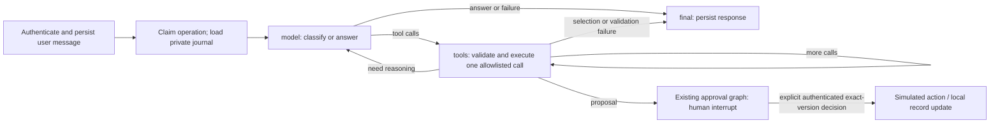

# Durable chat agent (Phase 3)

The API's `configure_chat` constructs `ChatAgentGraph` in LLM mode. This is the real
runtime path, not a demonstration graph. Demo command execution remains unchanged.
The same provider-neutral `ConversationalAgent` step functions implement validation,
budgets, model calls, tools and result validation; graph nodes contain no business calculations.

## Storage and identity

- `conversations.sqlite3`: authoritative transcript, operations, selections and private
  `AgentProgress` journal. Additive JSON fields require no SQL migration. Old rows default
  to demo mode. The API excludes private progress from operation serialization.
- `agent-checkpoints.sqlite3`: `SqliteSaver`, synchronous durability, no pickle fallback.
  `ChatGraphState` stores only version (`chat-agent-v1`), owner/conversation/operation UUIDs
  and routing stage. No prompts, profile/document payloads, secrets or bearer tokens.
- Thread key `chat-agent:<operation UUID>` is created server-side. Every node and recovery
  rechecks owner/conversation/operation mapping in the transcript store. There is no public
  arbitrary checkpoint read/update endpoint. Missing/incompatible checkpoints fail explicitly.
- Business objects and confirmed memory retain their existing stores. Approval checkpoints
  remain in `checkpoints.sqlite3` with the existing `approval:<thread UUID>` namespace.

`AgentProgress` holds bounded recent messages and tool-result projections, current calls,
selected resources, structured cards, counts, fingerprints, deadline and outcome. It is
application-owned continuation data, not confirmed profile memory. Deleting a conversation
cascades its journal, messages and operations. Checkpoint files contain opaque routing IDs;
include them in stopped-service backups and apply local retention policy.

## Continuation, approval and recovery

Missing job/profile selections preserve `Conversation.pending`/`awaiting`; only validated
selection events continue that task. An unrelated natural-language message calls the model
and cannot silently execute the old task. Missing profile facts require explicit editing in
the existing workspace; model prose never becomes a confirmed claim.

A proposal tool delegates to `Portal.propose`, which persists an immutable proposal then
pauses the existing approval graph with `interrupt`. The parent chat returns the exact
proposal card and `awaiting_approval` task status. It does not add a second approval authority.
Only `/api/threads/{id}/decision` uses authenticated `ReviewDecision` and `Command(resume=...)`.
Chat “yes”, checkpoint presence and model tool output are never approval. Refresh cards to
see the verified child workflow outcome; recovery never manufactures a decision.

A request has a 130-second execution lease, longer than its bounded run. Concurrent repeated
request keys return the same operation. An interrupted request may be explicitly refreshed
after lease expiry. Private journal progress survives restart; completed tool results are
not repeated when a graph checkpoint commit was interrupted. If a checkpoint has no scheduled
next task after a storage failure, routing is repaired from the authorized journal, retaining
counts and write markers. Recovery starts a new elapsed-time window but never resets model/tool
counts. A pre-call write marker without a committed result becomes **unknown**, with no retry.
Only explicit read-only model retries use the existing transient-error/backoff policy.

Missing/corrupt/incompatible checkpoint storage requires operator repair/restore; Refresh
cannot reconstruct evidence of an uncertain write. SQLite is intended for a single local
host. Tests exercise restart with fresh objects and actual SQLite files, not production
multi-host failover or arbitrary disk corruption recovery.

## Observability

Native graph/model content tracing is disabled even if global LangChain tracing is set.
The existing `LangSmithObserver` is opt-in (`CAREERPILOT_TRACE_ENABLED=true` and
`LANGSMITH_API_KEY`); it exports counts, node/tool names, latency, error categories and available
usage only. No prompt/document payloads. Logs continue to work without tracing. See
`observability-evaluation.md`. Live telemetry delivery has not been verified in this task.

Run `uv run --locked pytest tests/test_chat_graph.py tests/test_chat_agent.py` and the
complete `sh scripts/check.sh`. Standard tests block network access.
