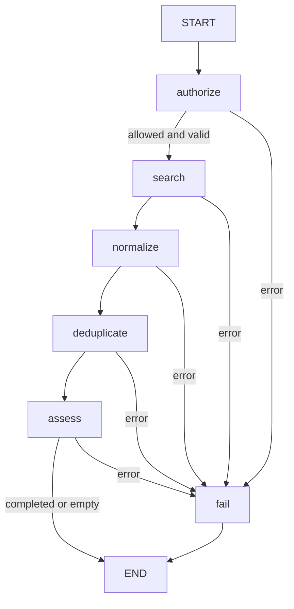

# Phase 5: job discovery and scoped tools

## Scope and run

This phase adds local job discovery, read-only retrieval tools and mock company
information. No commercial board, scraping, network source, model call or agent
loop is implemented. The Phase 3 graph and Phase 4 extraction adapter are preserved;
new optional tools are not automatically attached to the extraction model.

```sh
uv sync --locked
uv run --locked careerpilot-discover
uv run --locked careerpilot-discover --query Python --limit 1
uv run --locked careerpilot-discover --import-file examples/discovery/imported-jobs.json
sh scripts/check.sh
```

The CLI uses fixed synthetic IDs/time, an explicit demo-only access grant and a
fresh temporary SQLite DB, removed on exit. Its `--import-file` option is trusted
operator configuration, not an LLM tool argument. Actual request/result, imported
fixture, tool schemas and generated Mermaid graph are in `examples/discovery/`.
The sample searches four records across two sources, returns two jobs, removes two
duplicates and retains both sources for each. Outputs are regression-tested against
execution. Local invalid requests/source errors exit 2; empty results exit 0 with
`status=empty`. `completed` means execution completed, not that every job is eligible.

## Authorization and source registry

`DiscoveryTools` receives a frozen AccessGrant and a server-owned source registry.
The grant contains actor UUID, operation permissions, allowed source IDs, candidate
UUIDs and company IDs. Each operation checks its permission and resource scope
before reading data. All requested sources are checked before any is contacted.
The discovery graph additionally requires assessment permission and checks candidate
existence before searching. Grants never come from query text, files, model output,
tool arguments or graph state.

This implements authorization decisions, not a login/token/authentication system.
The trusted application must authenticate the user and verify ownership before
constructing a grant. There is no implicit wildcard/admin permission. Grant snapshots
have no production expiry/revocation service or database row-level security. Do not
let an external caller construct them, and do not share one user's bound tools with
another user. The demo grant authorizes one synthetic candidate only.

Source IDs are registered labels such as `synthetic` and `local`; they must match
`^[a-z][a-z0-9_-]{0,31}$`. Source adapters are trusted server code; source *content*
is untrusted. A model cannot register an adapter, choose a path or supply a fetch
endpoint. Job URLs/company URLs returned as metadata do not authorize a later fetch.

## Tool contracts

All core operations have Pydantic inputs/outputs independent of LangChain. Extra
input keys are rejected. UUIDs are validated, limits are strict integers, and all
responses obey a serialized payload limit. Public tool names below are the optional
LangChain bindings built by `build_discovery_tools(bound_service)`.

| Tool | Input | Output | Required permission and scope |
| --- | --- | --- | --- |
| search_synthetic_jobs | query (≤160 chars), limit (1–10; default 5) | SearchResults with ≤limit summaries, source references, duplicate count and more_available | search_jobs + source synthetic |
| search_local_jobs | query and limit, same schema | Same; uses server-registered local source only | search_jobs + source local |
| get_job | source_id, job_id UUID | RetrievedJob with validated JobPosting, canonical URL and trust marker | read_job + allowed source; ID must exist in that source |
| get_candidate_facts | candidate_id UUID, professional fields, per_field_limit (1–10; default 5) | CandidateFacts with requested claim records, evidence/proficiency states and omission counts | read_candidate + allowed candidate UUID |
| get_company_info | company_id (registered slug) | CompanyInfo: mock name/description, optional source URL, UTC retrieval time, untrusted_mock marker | read_company + allowed company ID |
| normalize_job_results | 1–30 source/job references across ≤3 sources, limit 1–10 | SearchResults after authorized reload, normalization and deduplication | search_jobs and read_job + all referenced sources |

Core `search_jobs` additionally accepts 1–3 unique source IDs; optional search
bindings deliberately fix their source server-side. There is no URL/path/SQL/shell/
actor/grant/permission field in any tool schema. Normalization accepts references,
not arbitrary job bodies that could be fabricated by a model. Job retrieval only
uses an authorized registered adapter; it is not an unrestricted repository query.

Candidate fields are skills, languages, experience, education, certifications and
work_authorized. Defaults request only skills/languages/work_authorized. Display
name/contact details are not exposed. `requested_fields` distinguishes unrequested
fields from empty collections; `omitted` gives per-field truncation counts. An
unrequested work_authorized is null, while a requested missing/unknown claim retains
its explicit Claim state; known False stays False. Evidence origins survive and no
profile mutation occurs. Omission-free output is complete only for requested fields.

Search summaries contain job UUID, title/employer, and all duplicate-member source
references. Each reference retains adapter ID, original job UUID, source name,
external source ID if present, original URL if present, canonical URL and aware UTC
retrieval timestamp. Returned content is data, never a permission or instruction.

## Local/imported source format

`JobSourceAdapter` has `search(query, limit, timeout_seconds=...) -> SourcePage` and
`get(job_id, timeout_seconds=...) -> JobRecord`. A JobRecord contains a validated
JobPosting and optional deterministic CriterionDefinitions tied to requirement IDs.
Missing definitions remain unknown; duplicate/wrong-job/wrong-category definitions
fail normalization instead of inventing semantics. The existing baseline is reused;
no free-text parsing, score or hiring probability is added.

The first adapter is LocalJobSource. It can be built from bundled synthetic records
or `LocalJobSource.from_file(operator_approved_path)`. File loading happens once
at registration; subsequent calls search an immutable in-memory snapshot. The input
is UTF-8 JSON with one `records` array, each containing `job` and optional
`definitions`. See `examples/discovery/imported-jobs.json` for the actual format.
CSV/PDF/HTML, arbitrary upload parsing, URLs and commercial APIs are unsupported.

The importer reads at most 256 KiB + one byte, rejects overflow, malformed JSON,
extra fields, duplicate JSON object keys, inconsistent same-ID records and over 100 records. Entity UUIDs/creation
times and source retrieval times must be explicitly supplied; import does not invent
new unstable IDs or pretend a file's read time is the source retrieval time. Missing
or inaccessible files return a safe source-data error without file contents. OS file
permissions and operator approval determine allowed input paths; no path is exposed
to the model. Source retrieval times and URLs are retained, not overwritten.

## Bounds, timeouts and errors

| Bound | Value |
| --- | --- |
| Sources per search/normalization | At most 3 unique registered IDs |
| Results per source and final search/assessment | 1–10; adapter must respect requested limit |
| Internal candidates | At most 30 (3 sources × 10 records) |
| Imported snapshot | At most 100 records and 256 KiB UTF-8 JSON |
| One job record with definitions | At most 16 KiB serialized UTF-8 |
| Batch/tool/assessment output | At most 128 KiB serialized UTF-8 |
| Candidate professional collections | At most requested per-field limit, with explicit omission counts |
| Adapter timeout argument | Default 5 seconds, finite and >0 up to 30; configured by the application |

These are fail-fast guards, not silent payload truncation. The only intentional
truncations are bounded result/field selection with `more_available` or omission
metadata. Search does not paginate beyond its first bounded page per source. Duplicate
pages may yield fewer unique results than requested. Source order determines stable
first-record selection; no market ranking or exhaustive search is implied.

No network operation exists in the supplied adapters. Every source/company call
receives the validated timeout budget, and TimeoutError maps to SourceTimeout.
A future network adapter must enforce connect/read/overall timeouts in its transport
and bound response bytes before parsing; this interface is not a watchdog that can
interrupt arbitrary misbehaving Python adapter code. Rate-limit signals retain a
nonnegative retry-after value if supplied; no automatic retry or delay is performed.
There is no cross-user rate scheduler/cooldown implementation for a real provider.

| Application error code | Meaning |
| --- | --- |
| invalid_input | Schema, query/count/ID or extra-key validation failed |
| access_denied | Bound grant lacks permission or resource scope |
| source_not_configured | Authorized source label was not registered |
| not_found | Authorized source job, candidate or company is absent |
| source_failure | Source adapter raised an unexpected failure |
| source_timeout | Source operation reported a deadline failure |
| source_rate_limited | Source declined due to rate/quota limits; retry hint retained |
| invalid_source_data | Malformed page/record/import or inconsistent definitions/IDs |
| payload_limit | Import, record or response byte limit exceeded |
| identity_conflict | Same identity disagrees, or a persisted duplicate would be overwritten |
| persistence_failure | Local transaction/infrastructure failure |

Core methods raise these documented errors with fixed safe messages. Raw adapter
exceptions/bodies, paths and content are not logged/echoed in errors. At the source
plugin boundary, unexpected exceptions are normalized; no failure becomes a partial
successful batch. LangChain bindings return explicit JSON `status=error` and, for a
ToolCall, ToolMessage status `error`. Schema errors are redacted. Graph failures are
DiscoveryFailure, never a completed-looking result with swallowed source failures.

## Normalization, deduplication and assessment

Pydantic strips bounded domain text, normalizes source names, validates URLs and
normalizes aware timestamps to UTC. Canonical URLs reuse the existing conservative
policy: strip fragments/common tracking parameters, preserve meaningful query values,
scheme and path distinctions, and never resolve redirects or fetch the target.

Duplicate keys are job UUID, `(source_name, external_id)` when available and canonical
URL when available. Grouping is transitive: an intermediate duplicate's URL/source
aliases are not lost. The first record in requested-source/page order is selected;
other records' references remain available for authorized get_job inspection. No
business rules/definitions are merged from conflicting versions. Same UUID with
different job/definition payloads is an explicit conflict. Missing identity keys do
not collapse unrelated jobs; no fuzzy title/employer merge is attempted.

Before persistence, selected records are reloaded by authorized references and must
match their searched snapshots. Existing persisted duplicates with different content
produce identity_conflict, not an overwrite. Jobs and assessments for the bounded
set are written in one transaction. A failure after an earlier assessment rolls back
the whole operation. No network operation runs inside that transaction. The existing
AnalysisService is reused against the transaction-scoped repository. Stable run/job
IDs and immutable source data support idempotent repeated assessment.



The actual generated diagram is `examples/discovery/workflow.mmd`. Typed graph state
contains the request and bounded transient hits/groups, not grants, full candidate
profiles or application documents. Raw request/hits/groups are cleared at the relevant
stage. The final result contains selected summaries/provenance and typed baseline
reports with known gaps/unknowns still visible. No source claim becomes an authenticated
fact or an automatic application action. `completed` is execution status only.

## Prompt injection and optional LangChain layer

The discovery graph performs no language-model call and never interprets retrieved
text as code, system policy, tool selection or access rights. Search queries are
literal casefolded words, not SQL/regex/shell expressions. Retrieved titles,
descriptions and evidence are untrusted strings. Optional tool descriptions and
outputs explicitly label that boundary; source content cannot modify the bound
AccessGrant. There is no shell, raw SQL, file-reading, unrestricted HTTP or message-
sending tool to escalate into. Loopback/private URLs can exist as inert source
metadata but are never fetched. Credentials in URL userinfo are rejected by schemas.

Trust labels are not a semantic prompt-injection detector or proof of truth. Future
LLM consumers must keep retrieved text in a data role, preserve system policy, enforce
these authorization checks on every call and use a trusted dispatcher allowlist.
No such autonomous model loop was added here. The Phase 4 native extraction model
remains tool-free. Tests include malicious system-style job text, attempted grant/
actor/path/URL overrides, inaccessible candidate IDs, and schema inventory checks.

The optional adapters use existing langchain-core **1.7.0** StructuredTool.from_function
with explicit Pydantic args_schema. Business functions never import LangChain.
Sync/async invoke disables LangSmith tracing and explicit callbacks, even under
enabled host tracing context. Both invoke paths and ToolMessage error status were
executed in tests; no live LLM credentials or requests are required. LangGraph is
still **1.2.18**. No dependency package was added for this phase.

Official references reviewed against installed signatures and executed behavior:

- [LangChain tools](https://docs.langchain.com/oss/python/langchain/tools)
- [StructuredTool at langchain-core==1.7.0](https://github.com/langchain-ai/langchain/blob/langchain-core%3D%3D1.7.0/libs/core/langchain_core/tools/structured.py)
- [LangGraph Graph API](https://docs.langchain.com/oss/python/langgraph/graph-api)

## Source limitations and future external adapters

No commercial job board is assumed to allow scraping or offer a usable public API.
Only local fixture/import and mock company adapters are shipped. Any future external
adapter requires explicit operator configuration, permission/terms review, approved
fixed endpoints/host allowlists, secret handling outside tool inputs, transport/body
limits, rate-limit handling, provenance and integration tests. A URL from the LLM or
a returned document must not become the fetch destination. Provider-neutral interfaces
are an extension seam, not evidence of implemented external compatibility.

SQLite schema v1 is unchanged; there is no data migration. Source alias groups and
search history are returned, not durably stored in a separate provenance/search ledger.
Production authentication, dynamic ACL revocation, external rate scheduling, source
editing/reconciliation and PostgreSQL/concurrent workloads remain future decisions.
All fixtures and examples are synthetic; no real user data, API key, live search or
production deployment was used.
