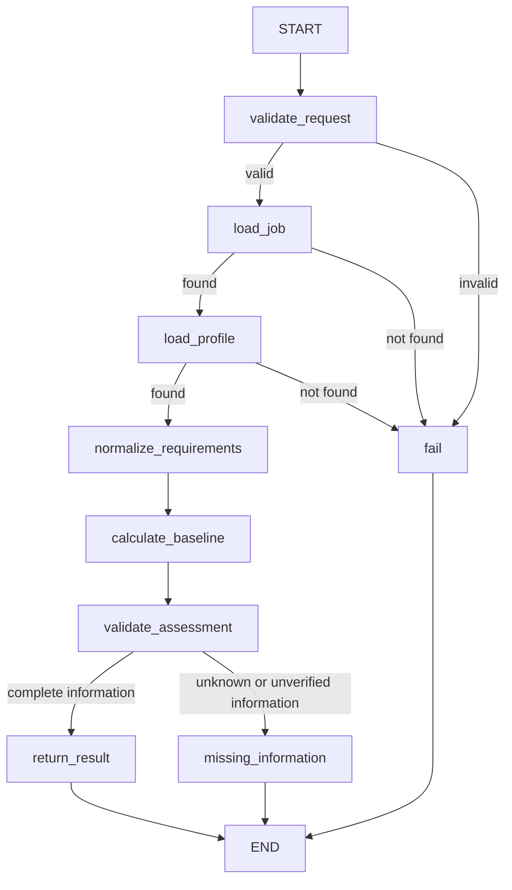

# Phase 3: deterministic job-analysis workflow

This describes the unchanged offline graph. Phase 4 adds an optional upstream
[structured extraction entry point](llm-integration.md); the original commands,
fixture outputs and deterministic business rules remain compatible.

The first CareerPilot graph runs locally, requires no model or key, and uses only
bundled synthetic data. It adds orchestration around independent domain rules and
application use cases. It does not generate documents, apply for jobs or search.

## Run and reproduce

```sh
uv sync --locked
uv run --locked careerpilot-demo
uv run --locked careerpilot-demo --scenario missing-information
uv run --locked careerpilot-demo --scenario hard-gap
uv run --locked careerpilot-demo --input examples/job-analysis/complete-input.json
sh scripts/check.sh
```

`careerpilot health` is unchanged. The separate demo composition root seeds a
fresh, temporary SQLite file, executes the actual compiled graph, prints JSON and
removes the temporary database. It never initializes or overwrites another DB.
Malformed/invalid requests and missing object references have exit code 2 and
`status: error`; unexpected runtime errors propagate with nonzero exit status.
Completed and information-needed analyses exit 0; callers must inspect both
`status` and `decision`, not treat an exit code as a hiring or submission decision.

## Workflow diagram



The exact diagram generated from the compiled graph is checked in as
[workflow.mmd](../examples/job-analysis/workflow.mmd). It is generated as text only;
no remote rendering API is called. The diagram and all sample outputs are compared
with actual execution in regression tests.

## Nodes and edges

| Node | Responsibility | State patch and outgoing edge |
| --- | --- | --- |
| validate_request | Pydantic-validates required request UUID, aware evaluation timestamp, job/candidate UUIDs; rejects extra fields and revalidates model instances | Clears raw input, sets validated request or fixed typed error; conditional edge to load_job or fail |
| load_job | Application service looks up the synthetic job in the repository | Only loaded job UUID; conditional edge to load_profile or fail(job_not_found) |
| load_profile | Loads the synthetic profile through the same port | Only loaded candidate UUID; conditional edge to normalization or fail(profile_not_found) |
| normalize_requirements | Pure normalizer maps fixture definitions to source requirement IDs, names and importance | Small criterion tuple; fixed edge to calculation |
| calculate_baseline | Calls pure baseline calculation with loaded domain objects, injected policy and deterministic identity | Transient baseline report; fixed edge to validation |
| validate_assessment | Recomputes canonical criteria/report, checks exact equality/references, then atomically inserts/reuses the domain assessment | Persisted UUID and needs-information flag; conditional edge to return_result or missing_information |
| return_result | Loads/compares the persisted assessment and builds typed output | Typed complete report; clears transient baseline; END |
| missing_information | Builds the same validated report with explicit needs_information status, preserving gaps/unknowns and decision | Typed partial report; clears transient baseline; END |
| fail | Returns the expected typed error code with no fabricated assessment | Error result; END |

START always enters request validation. Only validation/job/profile lookup failures
use the `fail` branch. Unknown requirement definitions or unverified profile facts
remain valid *unknown outcomes*, so the workflow calculates and validates a partial
report. Broken definitions (duplicates, wrong job/category), calculation failures,
validation mismatches and persistence failures raise exceptions; there is no
catch-all converting them to partial or successful results. Runtime exceptions
abort the current graph invocation; they are not normal successful terminal edges.

## State and persistence

`AnalysisInput` exposes only `raw_request`. `AnalysisState` is a TypedDict whose
nodes return partial updates; LangGraph's ordinary overwrite behavior is sufficient
for this sequential graph. `AnalysisOutput` exposes only the typed result union.
No message history, full job/profile or application document is copied into state.
IDs reference the previously persisted fixture objects. Small normalized criteria
and a transient assessment are needed by subsequent calculation/validation stages;
the final patch clears that transient baseline. Raw input is cleared immediately
after validation, and no state is traced or checkpointed remotely.

Requests require `id`, `created_at`, `job_id`, `candidate_id`; UUIDs/timestamps are
not generated implicitly at this boundary. The assessment UUID is uuid5 in the
request-ID namespace, over canonical JSON of request, policy and normalized criteria.
Evaluation time becomes the assessment's UTC creation time. Thus identical input,
policy and immutable source records yield identical output across fresh runs and
reuse the same stored assessment on replay. Changed policy/input gets a distinct
identity. An existing different domain assessment at that UUID raises
`AssessmentConflict`; it is never overwritten.

Each application operation owns a short repository transaction. No transaction is
held across graph execution. Only validated domain assessments are written; no
schema changes are required. Policy/normalization and explanations are returned
with the typed result, but are not a durable policy/history ledger in schema v1.
The replay guarantee relies on the current immutable profile/job storage API.
Future editing requires immutable snapshots/versioned references plus migrations.
There is no checkpoint/resume, retry scheduling or long-running job service.

## Deterministic criteria and policy

Fixture definitions bind requirement UUIDs to skill, language, work-authorization
or unsupported criteria. They specify names and optional minimum levels/expected
booleans. Source `mandatory=True` means hard constraint, `False` soft preference,
and `None` unspecified importance. Configuration cannot silently downgrade this.
Missing definitions become unknown; unexpected/duplicate IDs and category mismatches
are configuration errors. No free-text interpretation or LLM inference is used.

`BaselineRules` is injected at composition, not accepted from untrusted request
fields. It configures a version label, explicit aliases and accepted evidence origins.
Casefolding, whitespace collapse and one-step aliases normalize names. The bundled
alias maps “python programming” to “python”. No fuzzy matching, alias chaining or
synonym guessing is performed. Minimum levels are explicit criterion configuration;
there are no hidden experience/proficiency thresholds or weights.

| Situation | Finding |
| --- | --- |
| Trusted matching skill/language with sufficient stated level | Supported match (`met`) |
| Trusted level below an explicit minimum | Explicit gap (`unmet`) |
| Trusted authorization value differs from the explicitly required boolean | Explicit gap (`unmet`) |
| No matching skill/language record | Unknown (`not_recorded`), never proof of absence |
| Missing or explicitly unknown proficiency/authorization | Unknown (`unknown_value`) |
| Evidence only from AI inference or excluded by policy | Unknown (`unverified`) |
| Contradictory trusted matches above/below a threshold | Unknown (`conflicting_evidence`) |
| Unsupported requirement or missing deterministic definition | Unknown with a specific reason |
| Native-language label compared with a CEFR threshold | Unknown (`not_comparable`) |

Default trusted origins are user statement and source document. Policy may be made
stricter (e.g. user-statement-only) but cannot promote AI inference to a verified fact.
Skill presence and proficiency both need trusted evidence when a level is required.
Proficiency without trusted evidence for the skill record itself is insufficient.
Where several records match, conflicting decided outcomes require review; an
unverified duplicate does not erase a separately evidenced, consistent result.

Ordinal skill levels are beginner < intermediate < advanced < expert. CEFR levels
are A1 < A2 < B1 < B2 < C1 < C2. A native label is not automatically equated to a
CEFR qualification; native-to-native is the only native-label comparison.
These are deterministic declared-data comparisons, not competence measurements.

There is **no weighted score, percentage or probability**. The output contains
per-requirement evidence IDs, reasons, thresholds and seven counts: hard supported/
gaps/unknown, soft supported/gaps/unknown, and unspecified-importance requirements.
The existing domain decision rule returns ineligible for any trusted mandatory gap,
needs_review for unknown mandatory data/importance or an empty requirements list,
and eligible when explicit mandatory rules are cleared. Soft gaps do not reject
a candidate. Any unknown finding, unspecified importance or empty requirement list
routes the workflow to `needs_information`, even if known mandatory rules pass.
`completed` means the calculation has complete information, not that a candidate
is eligible. For example, the hard-gap scenario is completed + ineligible.

## Samples from actual runs

Full request/response pairs are in [examples/job-analysis](../examples/job-analysis/):

| Scenario | Actual status | Actual decision | Key counts |
| --- | --- | --- | --- |
| complete | completed | eligible | Hard supported 2; soft supported 1 |
| missing-information | needs_information | needs_review | Hard supported 2; soft supported 1, gap 1, unknown 1; unspecified 1 |
| hard-gap | completed | ineligible | Hard supported 1, gap 1; soft supported 1 |
| invalid input `{}` | error | No assessment | Code invalid_request |

Use `complete-input.json` and `complete-output.json` for the full input/output;
all IDs and times are fixed synthetic values. Results include criterion definitions,
policy, every finding and counts. `invalid-output.json` contains only an error code,
not echoed raw input or validation exception content.

## Reliability, versions and official references

Verified locally against **LangGraph 1.2.18**, **langchain-core 1.7.0**, **LangSmith
0.14.14**, Python 3.12.4, Pydantic 2.14.1 and SQLite 3.53.4. Exact dependencies are
locked in uv.lock. No provider SDK, agent abstraction or standalone LangChain package
was added. LangGraph brings networking/tracing libraries transitively; none is used
to call models or external services in this workflow.

Official references were reviewed before implementation, then checked against
installed method signatures and actual execution:

- [Thinking in LangGraph](https://docs.langchain.com/oss/python/langgraph/thinking-in-langgraph): separate business steps before state/nodes/transitions.
- [Graph API overview](https://docs.langchain.com/oss/python/langgraph/graph-api): TypedDict state, partial updates, START/END, conditional edges, compile/invoke/stream.
- [StateGraph source at 1.2.18](https://github.com/langchain-ai/langgraph/blob/1.2.18/libs/langgraph/langgraph/graph/state.py): constructor schemas, add_node, add_conditional_edges and compile signatures.
- [LangGraph 1.2.18 release](https://github.com/langchain-ai/langgraph/releases/tag/1.2.18): version-specific release context.
- [Official LangSmith tracing toggle guidance](https://kb.langchain.com/articles/2491399069-how-do-i-disable-or-toggle-langsmith-tracing-during-execution): scoped tracing_context(enabled=False).

The public `run()` and `updates()` runners disable tracing with the documented
context manager, even under enabled host tracing flags. LangSmith is declared as a
direct dependency solely for this local opt-out; no account/client/key is configured.
Tests deny socket connections and verify both runners remain local. Update streams
are local diagnostic data, not application logs; do not export them indiscriminately.

The fixture loader never overwrites existing mismatched IDs. The demo avoids this
risk entirely with a fresh temporary DB. No real user data, keys, external search,
API, production deployment or automatic application submission is implemented.
Synthetic evidence-origin declarations do not authenticate real actors/documents;
future authenticated ingestion/review is still required. Generic work authorization
is only a declared boolean and has no jurisdiction/legal verification. This baseline
cannot model job-market context, interview performance, recency, legal eligibility
or hiring probability, and unsupported criteria remain unknown.
