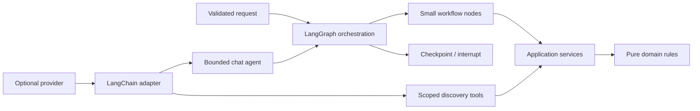

# LangGraph and LangChain in CareerPilot

## The split



CareerPilot uses the two libraries for different jobs:

| Technology | Actual role | Code |
|---|---|---|
| LangGraph | State, nodes, conditional edges, checkpoints, and approval interrupts | `workflows/job_analysis.py`, `workflows/chat_agent.py`, `workflows/action_approval.py` |
| LangChain Core | Runnable and tool interfaces at provider/tool boundaries | `workflows/chat_agent.py`, `tools/langchain.py` |
| LangChain OpenAI | Optional `ChatOpenAI` construction and structured output | `providers/factory.py` |
| LangSmith | Optional metadata tracing; disabled by default in local runs | `telemetry/langsmith.py` |

## Deterministic job analysis

`JobAnalysisWorkflow` builds a typed `StateGraph` with these nodes:

1. `validate_request`
2. `load_job`
3. `load_profile`
4. `normalize_requirements`
5. `calculate_baseline`
6. `validate_assessment`
7. `return_result` or `missing_information`
8. `fail` for typed failures

The graph only coordinates the process. `AnalysisService` and the baseline domain
rules perform the actual calculation, which keeps the important behavior testable
without LangGraph or a model. Conditional edges distinguish invalid input, missing
records, incomplete evidence, and a completed assessment.

## Chat agent graph

`ChatAgentGraph` creates one LangGraph thread per operation:

```text
model -> tools -> final
```

Its checkpoint contains only coordination references and a stage. Authoritative
conversation progress stays in the SQLite journal. On recovery, the graph reloads
the owner-bound operation and skips work already committed by the journal. A stable
thread ID and owner checks prevent a checkpoint from being reused across users.

## LangChain tools

`tools/langchain.py` exposes six bounded `StructuredTool` adapters:

- search synthetic jobs
- search registered local jobs
- retrieve a job
- retrieve candidate facts
- retrieve mock company information
- normalize and deduplicate job references

Each tool validates Pydantic input, calls an already-authorized application service,
limits the operation, clears callbacks, and labels returned source content as
untrusted. The model never receives a file path, SQL statement, shell command, or
arbitrary URL. Authorization is enforced before the LangChain boundary and cannot
be granted by a prompt or tool argument.

## Optional real model

`providers/factory.py` is the only place that constructs `ChatOpenAI`. It validates
provider settings, requires an explicit application API key, disables hidden SDK
retries, applies timeouts and output limits, and uses Pydantic schemas for structured
job extraction and draft planning. The deterministic mock/fixture path remains the
default for tests and offline development. A ChatGPT/Codex subscription credential
is not treated as an application API key.

## What the libraries do not decide

- Business fit rules and evidence interpretation are plain Python/domain code.
- User ownership and authorization are API/application checks.
- Approval is an authenticated application event, not an LLM response.
- Side effects run only through explicit adapters with idempotency and audit records.
