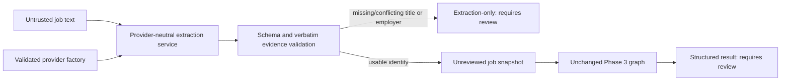

# Phase 4: LLM integration and structured extraction

## Supported modes and actual verification

| Mode | Adapter | Required configuration | Network |
| --- | --- | --- | --- |
| mock (default) | Deterministic fixture adapter | None; model unset or fixture-v1 | None; accepts only the bundled synthetic text |
| openai | LangChain ChatOpenAI, native structured output | Explicit model and OPENAI_API_KEY | Paid OpenAI API request when extraction is invoked |

Only these modes are implemented. Anthropic, Azure, local inference and arbitrary
OpenAI-compatible endpoints are not claimed supported. The application depends on
a small `JobModel` protocol and generic provenance, not OpenAI classes. A new
adapter implements that port and adds configuration/construction in providers;
it does not change domain calculations or graph nodes. No speculative extra SDKs,
agent, external service or tool executor was added.

Verified package versions: langchain-openai **1.7.3**, langchain-core **1.7.0**,
OpenAI SDK **3.40.0**, LangGraph **1.2.18**, Pydantic **2.14.1**, Python **3.12.4**.
The real LangChain/SDK structured-output path was exercised using an in-memory
HTTP transport, including schema parsing, malformed JSON and timeout behavior.
**No live model call was made.** Live account access, selected-model availability,
server-side schema acceptance and extraction quality have not been established by
these offline tests. The optional live smoke test remains skipped by default.

## Local usage and configuration

```sh
uv sync --locked
uv run --locked careerpilot-extract
uv run --locked careerpilot-extract --text examples/extraction/synthetic-job.txt
uv run --locked careerpilot-demo
sh scripts/check.sh
```

The extract command is a demo composition root with a synthetic candidate and a
fresh temporary SQLite database, cleaned up afterward. Mock output is reproducible
and regression-tested against `examples/extraction/mock-output.json`. Arbitrary text
in mock mode raises MockInputUnsupported; mock is not a general-purpose parser and
never fabricates generic success. Programmatic callers can use the same services
and repository transaction factory with their own approved candidate store.

Settings load from optional local `.env` and process environment (environment wins).
Provider construction is explicit, never on import or health startup. Secrets are
excluded from settings repr/serialization and from domain/persistence models.

| Setting | Default | Validation / purpose |
| --- | --- | --- |
| CAREERPILOT_LLM_PROVIDER | mock | mock or openai |
| CAREERPILOT_LLM_MODEL | unset | fixture-v1/unset for mock; explicit nonblank model ID for OpenAI |
| OPENAI_MODEL | unset | Shared model-name alias; used when the provider-specific model setting is absent |
| OPENAI_API_KEY | unset | Required nonblank secret for real mode; no application default |
| CAREERPILOT_LLM_TIMEOUT_SECONDS | 30 | Finite, greater than 0, at most 120; SDK request timeout |
| CAREERPILOT_LLM_MAX_RETRIES | 0 | SDK retries from 0 to 2; no application retry/repair loop |
| CAREERPILOT_LLM_MAX_OUTPUT_TOKENS | 4096 | 512–8192 maximum completion tokens |

To enable real mode, set `CAREERPILOT_LLM_PROVIDER=openai`, choose a model that
supports Chat Completions native JSON-schema output, and supply `OPENAI_API_KEY`
through your process environment, an ignored `.env` or your secrets manager.
`.env.example` contains safe mock defaults and commented placeholders only. Do not
paste real credentials into source, fixtures, shell scripts, reports or this chat.
A Codex/ChatGPT subscription is not an application API credential; no Codex token,
subscription login or local agent credential is read by this application.

The chat composition root uses the same OpenAI credential and accepts
`CAREERPILOT_CHAT_MODEL` or the shared `OPENAI_MODEL` alias. Provider-specific
settings take precedence over the shared alias. The configured model is never
validated against an assumed account catalog; availability is confirmed only by an
explicit live smoke test.

There is no hardcoded real-model default or automatic paid fallback. OpenAI uses
an explicit standard API endpoint, not an endpoint supplied by document text or
ambient custom-base-URL variables. The selected model must support native structured
output; known LangChain warnings that would downgrade to tool calling become
ProviderConfigurationError. Unknown model/access/schema incompatibility fails via
a provider error when invoked. No model compatibility is guessed from a subscription.

The existing health and Phase 3 deterministic commands remain usable even if separate
real-mode settings are incomplete. `careerpilot-extract` fails early with a safe,
useful configuration error naming model/key requirements. The mock path never
constructs a real client and needs no credential. Real extraction intentionally
sends the supplied job text to OpenAI; candidate records are not sent.

## Structured schema and provenance

Every scalar extracted claim has four required fields: state, value, evidence and
alternatives. Nullable values are explicit, not silently defaulted. The native
schema uses required object properties and rejects additional properties.

| State | Meaning | Validation |
| --- | --- | --- |
| missing | No statement found | Null value, no evidence/alternatives |
| unknown | Statement exists but is ambiguous | Null value and evidence; no alternatives |
| present | Extracted assertion, still unreviewed | Non-null typed value and evidence; no alternatives |
| conflicting | Contradictory statements | Null value, at least two distinct alternatives and distinct evidence quotes |

The schema covers title/employer, skills/minimum proficiency, qualifications,
experience/minimum years, languages/levels, location, remote/hybrid/onsite arrangement,
employment type and extraction warnings. Per-requirement mandatory values use strict
booleans: explicit False is distinct from missing/unknown. Years must be finite
and between 0 and 80. Empty category arrays mean no requirement was extracted;
they are not a completeness guarantee. A requirement entry must at least have a
stated/ambiguous primary name or description.

Job text is limited to 20,000 characters; each evidence quote is nonblank and at
most 1,000 characters; collection sizes and evidence/alternative counts are bounded.
All quotes must occur **verbatim in the submitted source**. Malformed output,
missing schema properties, extra candidate/tool/policy fields, invalid types or
ungrounded snippets raise explicit errors. Warnings for missing, ambiguous and
conflicting states are added deterministically even if the model omits their codes.

The application, not the model, attaches document UUID, SHA-256 source digest,
provider/model, prompt version, caller-supplied receipt timestamp and an immutable
`unreviewed_inference` trust label. Real CLI receipts use current UTC and fresh IDs;
the mock demo uses fixed synthetic identity/time for reproducibility. The full
source is not echoed in the result; supporting snippets are included. A source-hash
or verbatim quote proves text origin, not semantic entailment or truth. A malicious
or mistaken model can still misinterpret an authentic quote; review is required.

## Trust and reuse of the deterministic workflow



Messages contain a fixed system extraction policy plus a separate user message
whose JSON value holds the untrusted text. Embedded role labels, delimiters,
requests for tools, secrets or policy changes are data. There are no registered
tools or arbitrary prompt/config overrides. Native structured output is used,
not a function-executing agent. Unexpected tool calls in a response are rejected;
no document can grant an executable permission. Uploaded binary/PDF processing is
not implemented; any upstream upload-to-text adapter must preserve this boundary.

Candidate facts are never model inputs and cannot appear in the extraction schema.
The workflow checks candidate existence before spending a model call, then only
reads that candidate. It never updates or adds profile claims from model output.
Every prepared job requirement has AI_INFERENCE evidence locators. Suggested
mandatory/preferred flags remain visible in the extraction, but persisted mandatory
flags stay unknown until human review. Consequently all extraction-driven results
are explicitly `requires_review`; the inner deterministic result remains provisional
and needs information. It is not an automatic eligibility or hiring decision.

Supported skill/language definitions feed the existing baseline. Ambiguous thresholds
remain unsupported rather than silently relaxed. Qualifications, experience-year
calculations, location/arrangement and employment constraints are not automatically
matched against candidate facts in this phase. Metadata is retained in extraction;
unsupported requirements stay unknown. There is no new score, probability or
model-generated candidate-fact promotion. If title/employer is missing or conflicting,
no placeholder JobPosting is invented; analysis is null and review_reason explains it.

Job snapshot IDs bind document identity, receipt time, source hash, provider/model,
prompt and full validated extraction. Replay of an identical mock request reuses
identical data; differing real outputs make distinct snapshots. Database deduplication
still protects exact source identifiers; semantic deduplication of LLM snapshots is
not claimed. Existing schema v1 and existing models are unchanged. The extraction
and snippets are returned to the caller, while persisted jobs retain evidence
locators. A durable raw-source/extraction/policy ledger and a human promotion UI or
use case are not implemented. Add those explicitly before relying on long-term
review or editable source/profile history; do not label these snapshots verified.

## Failure and cost policy

ProviderConfigurationError, InvalidModelOutput (including UngroundedExtraction),
ProviderTimeout, ProviderAuthenticationError, ProviderRateLimited, ProviderFailure,
ModelRefusal and MockInputUnsupported are distinct public error types. Refusal,
truncation, invalid JSON, schema failure and missing parsed output do not become
empty successful results. Provider error bodies and raw responses are not serialized
or logged by the application; public messages are fixed/safe. Unexpected programming
or storage errors propagate. There is no fallback from a failed real call to mock.

Default retries are zero. Configured retries belong to the SDK, at most two, and
may repeat a request after a network/timeout failure; the timeout is not an overall
wall-clock deadline across retries. This is a bounded request policy, not a
production retry scheduler. A completion-token cap can cause truncation; truncation
is an explicit failure, never partially accepted output. No repair prompt creates
extra hidden calls. HTTP transports are simulated in ordinary tests.

Real API usage can cost money for input, system/schema overhead and generated
output; retries can add cost even when a prior request's response is lost. Character
and output-token limits are not a monetary budget or a token-perfect input cap.
Model rates and availability vary: consult the current official
[API pricing](https://developers.openai.com/api/docs/pricing) and your project's
billing/limits before enabling real requests. No price, account allowance or paid
access was assumed or verified in this phase. `store=False` is set, but it is not
a guarantee about every provider-side retention policy. No LangSmith trace is sent;
the provider adapter uses scoped tracing_context(enabled=False), as does the graph.
Do not enable SDK payload debug logging for real/private source text.

## Offline tests and explicit live opt-in

```sh
uv run --locked pytest
uv run --locked pytest -m 'not live_llm'
sh scripts/check.sh
```

Normal test fixtures clear ambient LLM provider/credential variables and deny socket
connections. No normal test can call the live API through this application. Mock
extracts only the exact fixture. In-memory HTTP tests exercise actual LangChain/
OpenAI parsing without opening sockets; synthetic credential placeholders are not
valid API keys. The live test is marked and skipped unless the explicit flag is used,
even when real credentials happen to be present.

For the paid smoke test, export provider=openai, a supported model and OPENAI_API_KEY
in the process environment first, then explicitly run:

```sh
CAREERPILOT_RUN_LIVE_TESTS=1 uv run --locked pytest -m live_llm --run-live-llm
```

Both the CLI flag and environment opt-in are required, plus valid real settings.
Live tests use a synthetic job and bypass the normal socket-denial fixture. Tests
isolate their working directory, so live credentials/settings must be exported;
a repository `.env` alone is not the documented live-test configuration. The smoke
test makes one logical extraction call (subject to configured SDK retries), checks
schema/grounding and an expected synthetic title, and may incur API cost. It was
**not run** as part of Phase 4. A failure is not silently skipped or treated as
completion when the operator explicitly selects the live test.

## Official API references reviewed

- [LangChain ChatOpenAI integration](https://docs.langchain.com/oss/python/integrations/chat/openai)
- [with_structured_output reference](https://reference.langchain.com/python/langchain-openai/chat_models/base/ChatOpenAI/with_structured_output)
- [Source at langchain-openai==1.7.3](https://github.com/langchain-ai/langchain/blob/langchain-openai%3D%3D1.7.3/libs/partners/openai/langchain_openai/chat_models/base.py)
- [Release 1.7.3](https://github.com/langchain-ai/langchain/releases/tag/langchain-openai%3D%3D1.7.3)
- [Official OpenAI structured outputs](https://developers.openai.com/api/docs/guides/structured-outputs)
- [Official OpenAI API authentication](https://developers.openai.com/api/reference/overview)

Installed constructor aliases and with_structured_output signatures were inspected,
and the supported native JSON-schema path was executed over simulated HTTP. There
was no need to change the existing LangGraph APIs or reroute its deterministic nodes.
